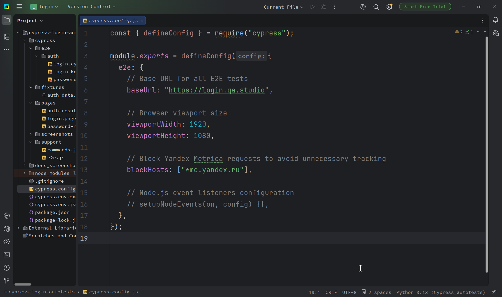
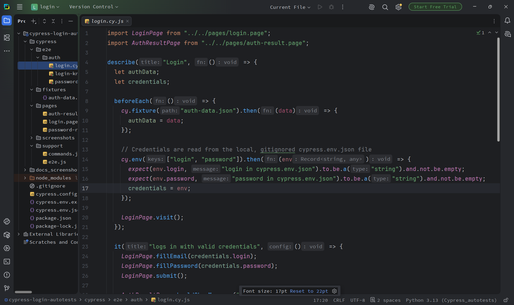
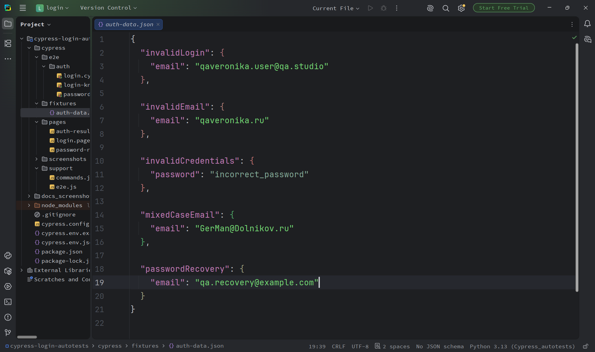
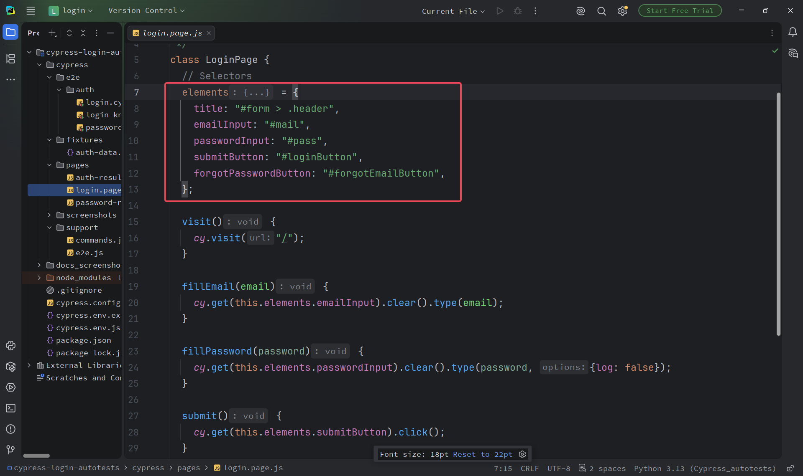
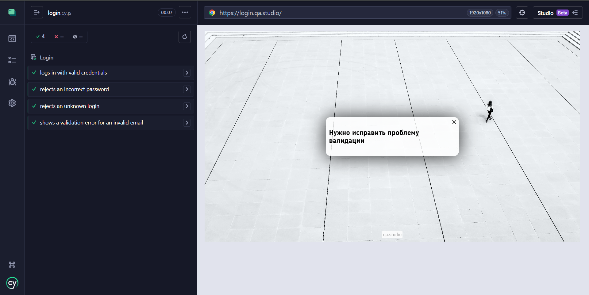
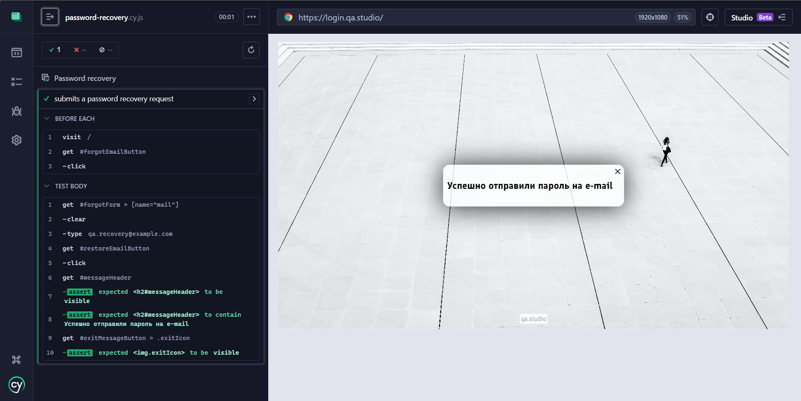
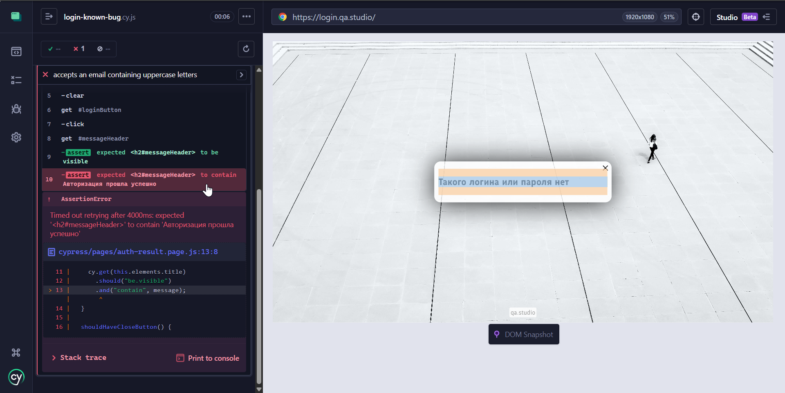
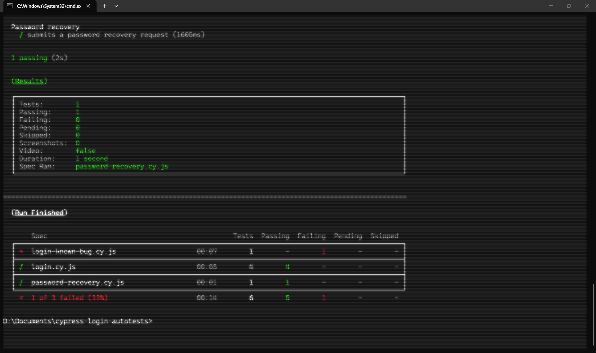

<h1 align="center">Cypress Login Autotests</h1>

Сквозные E2E-автотесты для проверки авторизации и восстановления пароля на сайте [login.qa.studio](https://login.qa.studio/). Проект создан для практики автоматизированного тестирования с использованием Cypress и JavaScript.

## Цель проекта

Цель проекта — автоматизировать проверку основных пользовательских сценариев формы авторизации и восстановления пароля, а также научиться организовывать E2E-тесты с использованием Cypress и паттерна Page Object Model (POM).

В рамках проекта реализованы проверки:

- успешной авторизации с корректными учетными данными
    
- обработки попыток входа с неверным паролем или неизвестным логином
    
- валидации адреса электронной почты
    
- поведения формы при вводе валидного адреса электронной почты с заглавными буквами
    
- отправки запроса на восстановление пароля
    
- отображения сообщений о результате выполнения действий
    

Отдельное внимание уделено проверке известного дефекта, который должен воспроизводиться с помощью автоматизированного теста. Требование из документации не соблюдается в системе:
	
> Поле для ввода имейла на клиенте должны приводить к строчным буквам. То есть неважно введёт пользователь имейл `maxim@qa.studio` или `maXim@qa.studio`, мы должны на проверку с клиента всегда посылать строчные символы.

## Технологический стек

| Технология              | Описание                                       |
| ----------------------- | ---------------------------------------------- |
| JavaScript              | Язык программирования для написания автотестов |
| Cypress 15.21.1         | Фреймворк для E2E-тестирования веб-приложений  |
| Node.js                 | Среда выполнения JavaScript                    |
| npm                     | Менеджер пакетов                               |
| Page Object Model (POM) | Подход к организации тестового кода            |
| Git и GitHub            | Контроль версий и хранение проекта             |

## Структура проекта

```
cypress-autotests-loginform/
├── cypress/
│   ├── e2e/
│   │   └── auth/
│   │       ├── login.cy.js
│   │       ├── login-known-bug.cy.js
│   │       └── password-recovery.cy.js
│   ├── fixtures/
│   │   └── auth-data.json
│   ├── pages/
│   │   ├── auth-result.page.js
│   │   ├── login.page.js
│   │   └── password-recovery.page.js
│   └── support/
│       ├── commands.js
│       └── e2e.js
├── docs_screenshots/
├── cypress.config.js
├── cypress.env.example.json
├── .gitignore
├── package.json
├── package-lock.json
└── README.md
```

### Назначение папок и файлов

- `cypress/e2e/auth/` — E2E-тесты авторизации и восстановления пароля.
- `login.cy.js` — проверки входа в систему, включая негативные сценарии и известный дефект.
- `login-known-bug.cy.js` — проверка известного дефекта.
- `password-recovery.cy.js` — проверки формы восстановления пароля.
- `cypress/fixtures/` — тестовые данные, используемые в сценариях.
- `auth-data.json` — тестовые данные для авторизации и восстановления пароля.
- `cypress/pages/` — Page Object-классы с действиями и селекторами страниц.
- `login.page.js` — методы взаимодействия с формой авторизации.
- `password-recovery.page.js` — методы взаимодействия с формой восстановления пароля.
- `auth-result.page.js` — проверки сообщений и элементов, отображающихся после выполнения действий.
- `cypress/support/commands.js` — пользовательские команды Cypress, если они используются в тестах.
- `cypress/support/e2e.js` — файл первоначальной настройки, подключаемый перед запуском E2E-тестов.
- `cypress.config.js` — конфигурация Cypress: настройки E2E, baseUrl и другие параметры.
- `cypress.env.example.json` — пример файла с переменными окружения для локальной настройки.
- `.gitignore` — список файлов, которые Git не должен добавлять в репозиторий.
- `package.json` — зависимости проекта и команды для запуска тестов.
- `package-lock.json` — зафиксированные версии зависимостей для более воспроизводимой установки.
- `docs_screenshots/` — скриншоты запуска тестов и результатов проверок для документации проекта.
- `README.md` — описание проекта, инструкции по установке и запуску.

## Покрытие тестами

### Авторизация

- Успешный вход с корректными учетными данными.
    
- Отклонение входа с неверным паролем.
    
- Отклонение входа с неизвестным логином.
    
- Проверка валидации адреса электронной почты без символа `@`.
    
- Вход с адресом электронной почты, содержащим заглавные буквы — сценарий с известным дефектом.
    
- Проверка отображения сообщения о результате и кнопки закрытия в сценариях, предусматривающих вывод результата.
	

### Восстановление пароля

- Отправка запроса на восстановление пароля.
    
- Проверка отображения сообщения о результате.
    
- Проверка наличия и доступности кнопки закрытия сообщения.

</br>

## Скриншоты реализации

**1. Конфигурация Cypress**

Настройки проекта, включая baseUrl, размер окна браузера и конфигурацию тестирования.

<p align="center">
  
</p>

**2. Подготовка тестов и загрузка Fixtures**

Импорт Page Object, загрузка тестовых данных и использование хука beforeEach.

<p align="center">
  
</p>

**3. Тестовые данные**

JSON-файл с тестовыми email и другими данными для сценариев авторизации.

<p align="center">
  
</p>

**4. Page Object Model**

Класс с локаторами элементов формы и методами взаимодействия с ними.

<p align="center">
  
</p>

## Требования

Установите версию Node.js, поддерживаемую Cypress 15.21.1, и npm. Если при установке возникают ошибки, ознакомьтесь с [системными требованиями Cypress](https://docs.cypress.io/app/get-started/install-cypress#System-requirements).

## Настройка проекта

#### 1. Клонирование репозитория

Откройте терминал и выполните команды:

```bash
git clone https://github.com/Tr-Veronika/cypress-login-autotests.git
cd cypress-login-autotests
```

Также можно скачать проект в формате ZIP с GitHub и распаковать архив вручную.

#### 2. Установка зависимостей

Выполните команду в корневой директории проекта:

```bash
npm install
```

#### 3. Настройка тестовых данных

Скопируйте файл `cypress.env.example.json` и переименуйте копию в `cypress.env.json`.

Укажите в нём актуальные значения `login` и `password` для тестового аккаунта.

> Файл `cypress.env.json` добавлен в `.gitignore` и не попадёт в репозиторий. Не публикуйте реальные учетные данные и токены.

## Запуск тестов

#### 1. Открыть Cypress Test Runner

```shell
npm run cy:open
```

Далее выбрать режим E2E Testing → выбрать E2E Testing → выбрать Google Chrome → открыть папку auth и выбрать файл для запуска тестов: `login.cy.js`, `password-recovery.cy.js`.

<p align="center">
  
  
</p>

#### 2. Запустить все тесты в безоконном режиме

```shell
npm run cy:run
```

#### 3. Запустить все тесты в браузере Chrome

Убедись, что Chrome установлен:

```shell
npm run cy:run:chrome
```

#### 4. Запустить тесты авторизации

```shell
npm run cy:run:login
```

#### 5. Запустить тесты восстановления пароля

```shell
npm run cy:run:recovery
```

#### 6. Запустить тест, который падает из-за известного дефекта (разный регистр валидной почты)

```shell
npm run cy:run:known-bug
```

<p align="center">
  
</p>

#### 7. Запустить тесты с выводом результатов в терминал

Все тесты:

```shell
npx cypress run --spec "cypress/e2e/auth/**/*.cy.js" --browser chrome
```

<p align="center">
  
</p>

Отдельный файл с тестами авторизации:

```shell
npx cypress run --spec "cypress/e2e/auth/login.cy.js" --browser chrome
```

Результаты выполнения тестов отображаются в терминале, а скриншоты и видеозаписи (если включены в конфигурации) сохраняются в папках `cypress/screenshots` и `cypress/videos` соответственно.

## Особенности реализации

- **Page Objects** позволяют хранить селекторы и действия со страницами отдельно от тестовых сценариев.
    
- **Fixtures** содержат тестовые данные, не являющиеся секретными.
    
- Учетные данные тестового аккаунта считываются из локального файла окружения, исключенного из Git.
    
- Тест с адресом электронной почты, содержащим заглавные буквы, представляет собой проверку известного дефекта: согласно документированному требованию, клиент должен преобразовывать адрес электронной почты к нижнему регистру. Ожидается, что тест будет завершаться ошибкой до исправления дефекта. Проверка выполняется в рамках сценария авторизации в систему.
    
- Селекторы и ожидаемые сообщения интерфейса основаны на предоставленной документации проекта. Если интерфейс тестового приложения изменится, их необходимо повторно проверить на актуальной версии приложения.
